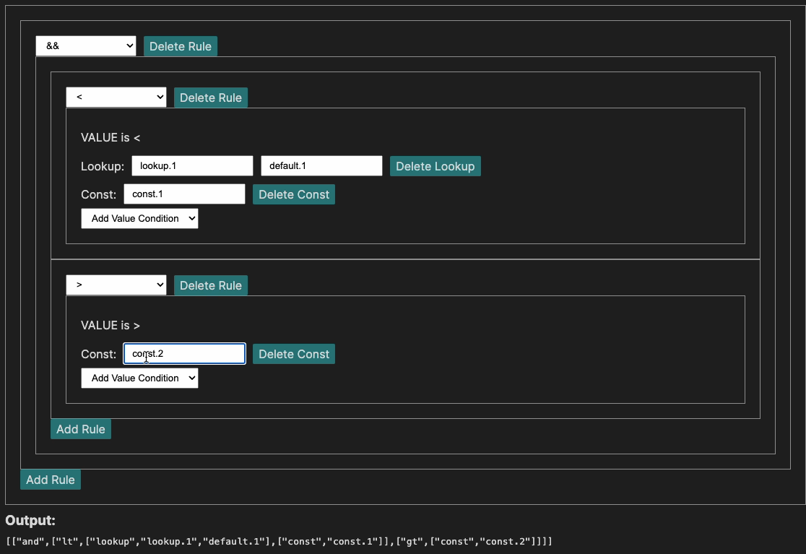

# Caesar Rule Builder

A visual rule builder for [Zooniverse's Caesar](https://github.com/zooniverse/caesar) reduction system. Build nested conditional rules as JSON arrays — zero dependencies, zero build step.



## Usage

Open `index.html` in a browser, or visit the [live site](https://zooniverse.github.io/caesar-rules-ui/).

## Examples

```json
["gt", ["lookup", "test_data_stuff", 0], ["const", 3]]
```

## References

- https://zooniverse.github.io/caesar/#conditions
- https://panoptes-python-client.readthedocs.io/en/latest/user_guide.html#caesar-features-by-workflow
- https://github.com/zooniverse/panoptes-python-client/pull/275
